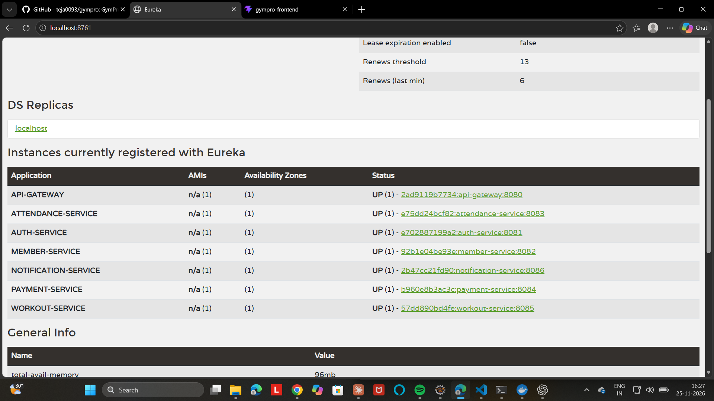
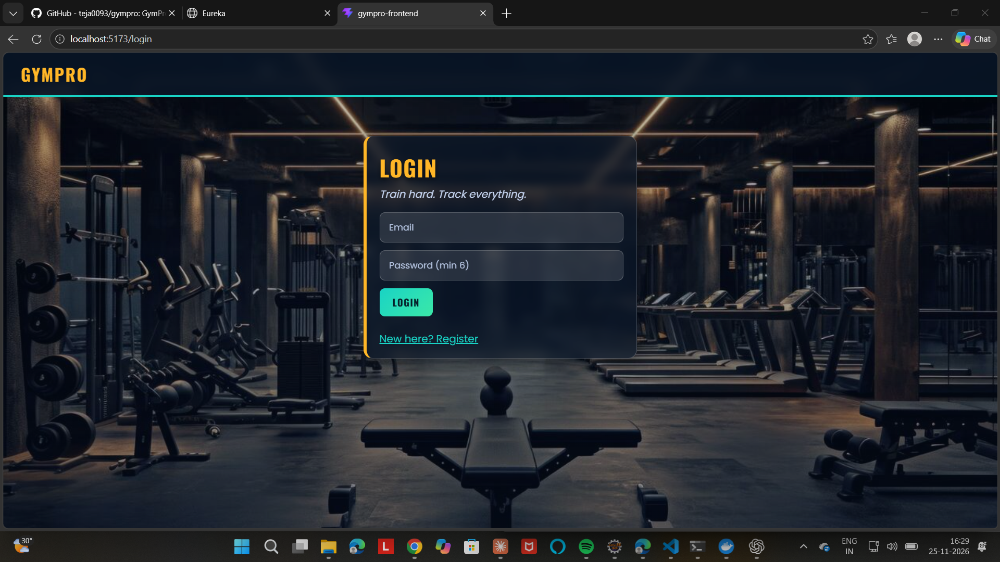
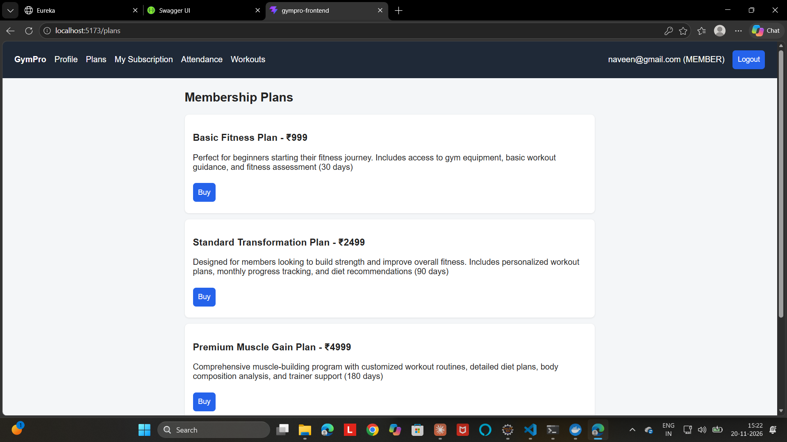
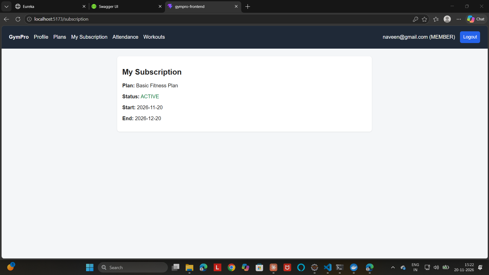
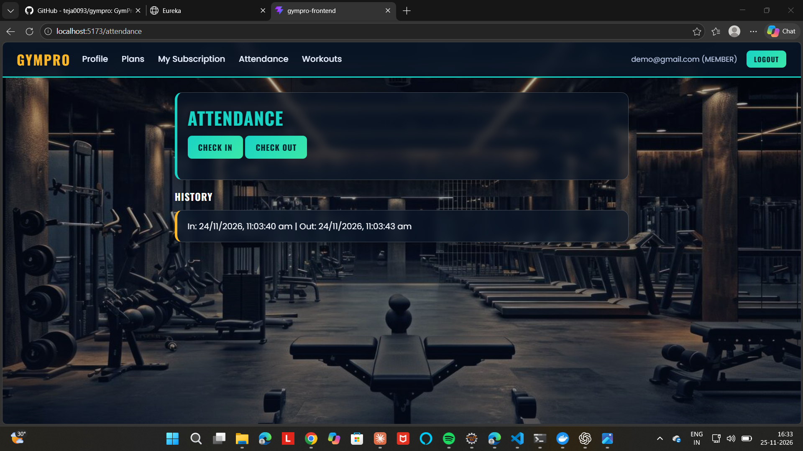
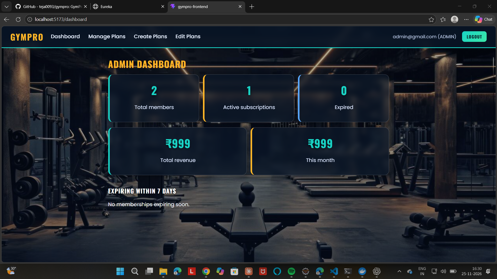
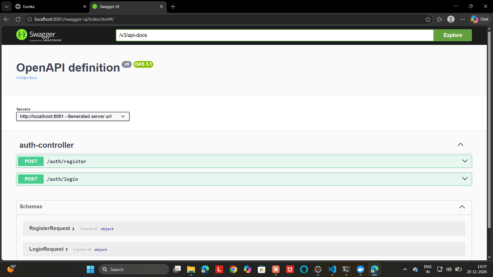
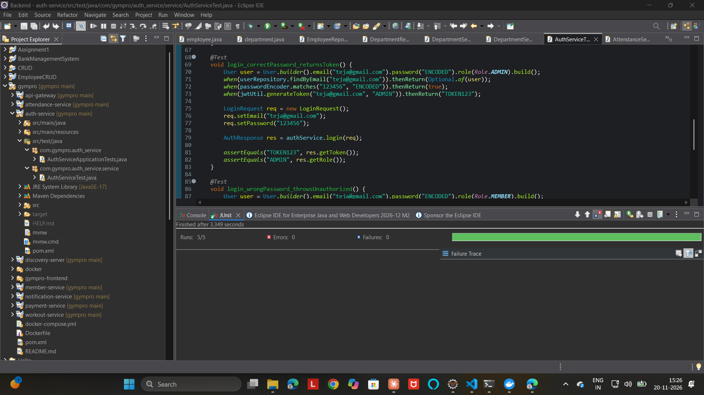
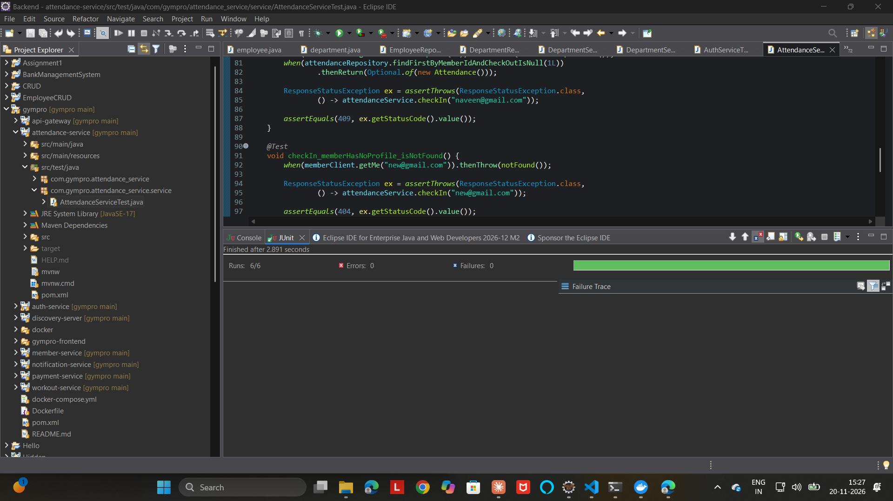

# GymPro

**Demo video:** https://youtu.be/ArG_TlHiYjk

Gym management system built with **Spring Boot microservices** and a **React** frontend. The whole application (backend and website) runs with one Docker command.

## Architecture

Client → API Gateway (JWT check) → Services (each with its own MySQL database)

```
                  React Frontend (nginx in Docker, 5173)  /  Postman  /  Swagger
                                  |
                       API Gateway (8080)  validates JWT, CORS
                                  |
   ---------------------------------------------------------------------------
   |            |               |               |              |             |
auth-service  member-service  attendance-    workout-      payment-     notification-
(8081)        (8082)          service (8083) service (8085) service (8084) service (8086)
   |            |               |               |              |
auth_db       member_db      attendance_db   workout_db     payment_db

        Discovery Server (Eureka, 8761): all services register here
```

8 Spring Boot applications: 7 microservices registered in Eureka, plus the Eureka server itself.

The gateway validates the JWT and forwards the user's email and role to each service as the headers `X-User-Email` and `X-User-Role`. The services never handle tokens themselves.

## Services

| Service | Port | What it does |
|---|---|---|
| discovery-server | 8761 | Eureka service registry |
| api-gateway | 8080 | Single entry point, routing, JWT validation, CORS |
| auth-service | 8081 | Register, login, JWT token, roles (ADMIN, TRAINER, MEMBER) |
| member-service | 8082 | Membership plans, member profiles, subscriptions, daily expiry job, admin dashboard |
| attendance-service | 8083 | Check-in / check-out, uses OpenFeign to verify an active membership |
| payment-service | 8084 | Creates payment orders, verifies payments (Razorpay or mock mode), activates the subscription, triggers a notification |
| workout-service | 8085 | Trainers create, edit and delete workout and diet plans; members view their own |
| notification-service | 8086 | Receives requests from payment-service and sends emails (mock mode: written to the log) |
| gympro-frontend | 5173 | React web app (served by nginx in Docker) with member, trainer and admin pages |

## Tech Stack

**Backend:** Java 21, Spring Boot 4, Spring Cloud (Gateway, Eureka, OpenFeign), Spring Security, JWT, Spring Data JPA, MySQL, Razorpay, Swagger (springdoc OpenAPI), Maven

**Frontend:** React, Vite, React Router, Axios, custom CSS gym theme

**Testing:** JUnit 5, Mockito

**DevOps:** Docker, Docker Compose, nginx, Git

A parent `pom.xml` groups all backend services so they open together as one project in Eclipse.

## Key Features

- JWT authentication with role-based access (ADMIN, TRAINER, MEMBER)
- Each service has its own database
- Service-to-service calls with OpenFeign
- Scheduled job that expires old subscriptions
- Check-in is rejected if the membership is expired
- Trainers and admins create, edit and delete workout and diet plans; duplicate plans for the same member and title are rejected
- Members see only their own workout and diet plans
- Payment flow: create order, verify payment, then the subscription is activated automatically
- Confirmation notification after a successful payment; a notification failure never fails the payment
- Razorpay integration with a **mock mode** for local development (no real keys needed)
- A member cannot subscribe without paying: the subscribe endpoint accepts only internal calls from payment-service (shared internal key)
- Global exception handling: every error returns the same clean JSON format
- Admin dashboard: total members, active/expired subscriptions, revenue, and memberships expiring within 7 days
- Swagger UI on every service for API documentation and testing
- Unit tests with JUnit 5 and Mockito for auth, attendance, member and payment services
- Dockerized: backend and frontend run with one `docker compose` command
- CORS configured in the gateway for the frontend
- Login session lasts only for the browser tab (sessionStorage); expired tokens send the user back to the login page
- Daily job sends a reminder 2 days before a membership expires

## Screenshots

**Eureka dashboard (all services registered)**



**Login and plans**




**Member pages**




**Admin dashboard**



**API documentation (Swagger)**



**Unit tests passing**

AuthServiceTest:



AttendanceServiceTest:



## Design Decisions

- **Database per service:** services never share tables, so each one can change and scale on its own.
- **Gateway handles security:** the JWT is checked once at the gateway, and the services trust the `X-User-*` headers.
- **Sync calls with OpenFeign:** attendance-service asks member-service whether a membership is active before allowing check-in. If member-service is down, the user gets a clear 503 message.
- **Pay before subscribe:** the subscribe endpoint is locked with an internal key, so only payment-service can activate a subscription after a verified payment.
- **Pluggable payments and email:** Razorpay or mock mode is chosen with one setting (`RAZORPAY_MOCK`); the notification service logs emails in mock mode and can be switched to real email later.
- **Failure isolation:** if notification-service is down, payments still succeed and only a warning is logged.
- **Configuration through environment variables:** database host, password and Eureka URL come from the environment, so the same code runs locally and in Docker. Secrets stay in a git-ignored `.env` file.
- **Roles are assigned in the database:** the public register form always creates a MEMBER, so nobody can make themselves an admin from the website.

## Frontend Pages

| Role | Pages |
|---|---|
| Member | Profile, Plans (buy), My Subscription, Attendance (check-in/out and history), Workouts and Diet |
| Trainer | Create Plans (workout and diet), Edit Plans (load a member's plans, edit or delete) |
| Admin | Dashboard (members, revenue, expiring memberships), Manage Plans, Create Plans, Edit Plans |

## Payment Flow

1. Member calls `POST /payments/create-order` with a plan id. payment-service reads the plan price from member-service and creates an order.
2. Member pays (the Razorpay checkout page in the real app).
3. Member calls `POST /payments/verify` with the order id, payment id and signature.
4. If the signature is valid, the payment is marked `SUCCESS` and payment-service tells member-service to activate the subscription.
5. payment-service asks notification-service to send a confirmation email.

**Mock mode** (default, `RAZORPAY_MOCK=true`): no Razorpay account is needed, and the signature `mock_success` counts as a valid payment. For real Razorpay test mode, set `RAZORPAY_MOCK=false`, `RAZORPAY_KEY_ID` and `RAZORPAY_KEY_SECRET`.

## How to Run

### Option 1: Docker (recommended)

1. Install Docker Desktop and start it.
2. Copy `.env.example` to `.env` and set `DB_PASSWORD` to any password you like.
3. Run:

```
docker compose up --build
```

4. Open http://localhost:8761 to see the registered services (give it 2 to 3 minutes).
5. Open http://localhost:5173 for the website.
6. Create the first users (see "First-time setup" below).

### Option 2: Run from Eclipse or IntelliJ

1. Create the MySQL databases: `auth_db`, `member_db`, `attendance_db`, `workout_db`, `payment_db`
2. Set the environment variable `DB_PASSWORD` to your MySQL password (for auth, member, attendance, workout and payment services)
3. Start the services in this order: discovery-server, auth-service, member-service, attendance-service, workout-service, notification-service, payment-service, api-gateway
4. Open http://localhost:8761 to see the registered services
5. Run the frontend:

```
cd gympro-frontend
npm install
npm run dev
```

Open http://localhost:5173.

### First-time setup

The database starts empty and every new account is a MEMBER. To create an admin and a trainer:

1. Register `admin@gmail.com` and `trainer@gmail.com` on the website.
2. Promote them in MySQL (Docker):

```
docker compose exec mysql sh -c "mysql -uroot -p\"$MYSQL_ROOT_PASSWORD\" -e \"UPDATE auth_db.users SET role='ADMIN' WHERE email='admin@gmail.com'; UPDATE auth_db.users SET role='TRAINER' WHERE email='trainer@gmail.com';\""
```

3. Log in again (the role is stored in the token), create a plan in **Manage Plans**, then register a member, create a profile and buy the plan.

### Useful Docker commands

| Command | What it does |
|---|---|
| `docker compose up -d` | Start everything in the background (no rebuild) |
| `docker compose up -d --build <service>` | Rebuild and restart one service after changing its code |
| `docker compose ps` | Show running containers |
| `docker compose logs <service> --tail 30` | Show the latest logs of a service |
| `docker compose logs -f notification-service` | Watch the "emails" being sent |
| `docker compose down` | Stop everything (data is kept) |
| `docker compose down -v` | Stop everything and delete the database data |

## Running the Tests

```
cd auth-service
mvnw test -Dtest=AuthServiceTest

cd ../attendance-service
mvnw test -Dtest=AttendanceServiceTest

cd ../member-service
mvnw test -Dtest=MemberServiceTest

cd ../payment-service
mvnw test -Dtest=PaymentServiceTest
```

The tests use Mockito to fake the database and the other services, so no MySQL or Eureka is needed.

| Test class | What it checks |
|---|---|
| AuthServiceTest | Passwords are stored encoded, duplicate emails are rejected, wrong passwords get no token |
| AttendanceServiceTest | Check-in is blocked without an active membership, double check-in is rejected, check-out rules |
| MemberServiceTest | One profile per user, subscription end date, no double subscription, daily expiry job |
| PaymentServiceTest | Order amount in paise, wrong signature is rejected, subscription activates only after a verified payment |

## API Documentation (Swagger UI)

| Service | Swagger URL |
|---|---|
| auth-service | http://localhost:8081/swagger-ui.html |
| member-service | http://localhost:8082/swagger-ui.html |
| attendance-service | http://localhost:8083/swagger-ui.html |
| payment-service | http://localhost:8084/swagger-ui.html |
| workout-service | http://localhost:8085/swagger-ui.html |

Services behind the gateway read the headers `X-User-Email` and `X-User-Role`. In Swagger, fill these in by hand (for example `X-User-Role: ADMIN`). Through the gateway on port 8080 they are added automatically from the JWT. (With Docker, the service ports are only reachable through the gateway on 8080, so Swagger works when the services run from Eclipse or IntelliJ.)

## Main API Endpoints

| Method | Endpoint | Who can use it |
|---|---|---|
| POST | /auth/register | Everyone (always creates a MEMBER) |
| POST | /auth/login | Everyone |
| POST | /plans | ADMIN |
| GET | /plans | Any logged-in user |
| GET | /plans/{id} | Any logged-in user |
| PUT | /plans/{id} | ADMIN |
| DELETE | /plans/{id} | ADMIN |
| POST | /members/profile | Logged-in user |
| GET | /members/me | Logged-in user |
| GET | /members | ADMIN, TRAINER |
| POST | /members/subscribe/{planId} | Internal only (called by payment-service after payment) |
| GET | /members/{id}/subscription | Logged-in user |
| GET | /members/dashboard | ADMIN |
| POST | /payments/create-order | MEMBER |
| POST | /payments/verify | MEMBER |
| GET | /payments/me | MEMBER |
| GET | /payments | ADMIN |
| POST | /attendance/check-in | MEMBER (active subscription needed) |
| POST | /attendance/check-out | MEMBER |
| GET | /attendance/me | MEMBER |
| GET | /attendance/member/{id} | ADMIN, TRAINER |
| POST | /workouts/plans | TRAINER, ADMIN |
| PUT | /workouts/plans/{id} | TRAINER, ADMIN |
| DELETE | /workouts/plans/{id} | TRAINER, ADMIN |
| GET | /workouts/member?email= | TRAINER, ADMIN |
| POST | /workouts/diets | TRAINER, ADMIN |
| PUT | /workouts/diets/{id} | TRAINER, ADMIN |
| DELETE | /workouts/diets/{id} | TRAINER, ADMIN |
| GET | /workouts/diets/member?email= | TRAINER, ADMIN |
| GET | /workouts/my-plans | MEMBER |
| GET | /workouts/my-diets | MEMBER |
| POST | /notifications/send | Internal only (called by payment-service, not exposed by the gateway) |
| POST | /members/send-reminders | ADMIN |

## Known Limitations

- If activation fails after a successful payment, the payment stays `SUCCESS` and needs manual follow-up. A retry or refund step is planned.
- Emails are written to the log (mock mode); real email sending is planned.
- Unit tests cover auth, attendance, member and payment services; workout-service is planned.
- Services run locally with Docker; cloud deployment is planned.

## Roadmap

- Real email sending (Spring Mail) 
- Unit tests for workout-service
- Cloud deployment with a live link

## Author

Teja - https://github.com/teja0093